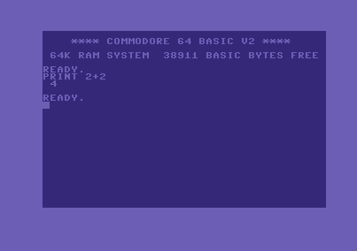
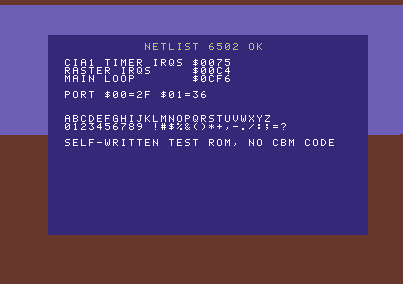

# C64 harness: netlist 6502 + pin-level board

A headless Commodore 64 emulator in C. The CPU is a switch-level simulation of
the visual6502 NMOS 6502 transistor netlist, wrapped in a hand-written 6510 I/O
port. The other chips are behavioral:

* the cycle-exact 6569 VIC-II from `../vic2/` (built directly from
  `../vic2/vic.c`, no copy);
* the 6581/8580 SID model from `../sid/` (built from `../sid/sid.c` and
  `../sid/wav.c`), behind the pin wrapper `src/sidpins.c`;
* this harness's own 6526 CIA, PLA (from the dumped equations) and board.

Each chip talks to the board only through a 64-bit pin mask
(`pins = chip_tick(&chip, pins)`), so a netlist-derived chip can later replace
any of them, one at a time.

**Status:** the original Commodore ROMs boot to `READY.` on the netlist CPU,
and typed input works (`PRINT 2+2` prints ` 4`). A self-written test ROM also
runs, exercising IRQs, raster split, badline stalls and banking. PRGs can be
autostarted (`--prg`), PSID tunes played (`--psid`), and the whole machine
saved and restored bit-identically (`--save-state`/`--load-state`). Frames
(`--dump-frames`), audio (`--wav`) and SID writes (`--sid-log`) can be
recorded. All code in `harness/` is written for this project; no third-party
code is used. The netlist data files, ROM images, PRG and SID tunes are data
and run only inside the emulated machine.

 

## Build and run

```
make                 # clang -O3; generates gen/*.h with python3 -I (stdlib only); links -lz -lm
./c64 --cpu-test     # hand-written instruction tests on the netlist CPU (52 checks)
./c64 --cia-test     # 6526 timer / ICR pipeline checks (34 checks)
./c64 --cpu-bench 300000            # netlist CPU alone, cycles/s
./c64 --test-rom --frames 100 --screen-text --stats --screenshot out/test.png
./c64 --rom-dir roms --cpu netlist --frames 300 --until-text READY. --screen-text --stats --screenshot out/basic_ready.png
./c64 --rom-dir roms --cpu netlist --frames 400 --type "PRINT 2+2\n" --until-text " 4" --screen-text --screenshot out/basic_print.png
./c64 --rom-dir roms --prg ../demo/minimalistic/prg/minimalistic_fig.prg --frames 900 \
      --dump-frames out/intro --wav out/intro.wav --sid-log out/intro_sid.log --save-state out/intro_f900.state
./c64 --psid ../demo/minimalistic/dl/minimalistic.sid --frames 300 --sid-log out/psid_sid.log --wav out/psid.wav
make test            # CPU tests, CIA tests, test ROM, BASIC boot
```

| option | meaning |
|---|---|
| `--rom-dir DIR` / `--test-rom` | ROM directory (default `roms`) / built-in self-written test KERNAL |
| `--cpu netlist\|compiled\|fast`, `--sid-model 6581\|8580` | CPU core (see "CPU cores" below; default netlist), SID model (default 6581) |
| `--frames N` / `--cycles N` | run length (default 50 frames). Counted from the start, or from the loaded state |
| `--until-text STR` | stop once STR is on screen, after one more frame so the screenshot shows it |
| `--type STR`, `--type-at-frame N` | keystrokes through the CIA1 keyboard matrix (`\n` = RETURN), when `READY.` appears or at frame N |
| `--prg FILE` | autostart (like VICE `-autostartprgmode 1`): at `READY.`, copy the PRG to its load address and set `$2D/$2E`, `$2F/$30`, `$31/$32` and `$AE/$AF` to the end address as LOAD would (`$2B/$2C` unchanged). Then type `RUN`+RETURN. The injection cycle and the cycle when RETURN is released are printed |
| `--psid FILE`, `--song N` | PSID player (see below) |
| `--save-state F` / `--load-state F` | complete machine state at the end of a run / at the start |
| `--screenshot P` | full 403×284 frame buffer (indexed PNG) |
| `--dump-frames DIR`, `--dump-from F`, `--dump-count N` | each completed frame as `DIR/frame_NNNNN.png`, cropped to VICE "normal borders" 384×272 (`vic_crop_normal`) |
| `--wav F` | SID audio, 44.1 kHz mono 16-bit, locked to emulated time (one sample per 22.341 cycles) |
| `--sid-log F` | one line per SID register write: `cycle frame line rasterCycle reg value` (reg/value hex; `line`/`rasterCycle` = VIC structural line 0..311 and cycle 1..63) |
| `--frame-log F` | one line per frame: `frame end_cycle sid_writes irqs nmis badlines cpu_stalled` |
| `--watch ADDR` | report the first opcode fetch at ADDR (hex, up to 8) |
| `--screen-text`, `--trace N` / `--trace-at C`, `--stats`, `--state-hash` | text screen; per-cycle bus trace; statistics; FNV-1a hash of the complete machine state |

**Linker note:** on this Mac the default SDK (MacOSX27) has a `libSystem.tbd`
that the installed `ld` cannot parse (`unknown architecture arm64e.x1`). The
Makefile test-links a trivial program and, if that fails, adds
`-isysroot` for the newest older SDK that links (here MacOSX26.5).

**Speed:** booting to `READY.` takes about 2.15 M emulated cycles (109 frames).
At ~50k cycles/s that is about 40 s; the last measured boot took 41 s wall.

## Where the ROMs go

Put the three images in a directory and pass it as `--rom-dir`. In this
checkout they are already in `harness/roms/`:

| ROM | size | file names tried, in order |
|---|---|---|
| KERNAL 901227-03 | 8192 | `kernal-901227-03.bin`, `kernal.901227-03.bin`, `-02`/`-01` variants, `kernal.bin`, `kernal.rom`, `kernal` |
| BASIC 901226-01 | 8192 | `basic-901226-01.bin`, `basic.901226-01.bin`, `basic.bin`, `basic.rom`, `basic` |
| CHARGEN 901225-01 | 4096 | `chargen-901225-01.bin`, `chargen.901225-01.bin`, `characters-901225-01.bin`, `characters.901225-01.bin`, `chargen.bin`, `chargen.rom`, `characters.bin`, `chargen` |

Files must have exactly the right size. With `--test-rom` plus `--rom-dir`, the
KERNAL is replaced by the test ROM, and BASIC/CHARGEN come from the directory.

## Architecture

```
            +-------------------- board (c64.c), one c64_tick() = one PHI2 cycle ----------------+
            |                                                                                      |
  1 PHI1    |  vic_tick(PHI0=0) --BA,AEC,/IRQ, fetch VA0-13 (every PHI1: g/p/s/refresh/idle)-->     |
            |     PLA(_AEC=1,VA12,VA13,_VA14=CIA2 PA0) <--D0-11 (RAM|CHAROM + colour nybble)       |
  2 CPU     |  m6510_tick: RDY=BA, AEC, /IRQ=VIC|CIA1, /NMI=CIA2|RESTORE, /RES, P0-5 pull-ups,      |
            |              D0-7 = previous read  -->  A0-15, R/W, SYNC, D0-7 (write), P0-5           |
            |     (port6510.c wraps netcpu.c: $00/$01 answered by the port, writes also hit RAM)    |
  3 PHI2    |  if AEC: PLA(A12-15,R/W,BA,_LORAM/_HIRAM/_CHAREN=P0-2,_GAME,_EXROM) ->                |
            |          RAM | BASIC | KERNAL | CHAROM | I/O --74LS139--> VIC SID COLOR CIA1 CIA2 IO1/2 |
  4         |  cia_tick x2, sidpins_tick: /CS, R/W, RS, D, PA/PB (keyboard, VIC bank, IEC)         |
  5 PHI2    |  vic_tick(PHI0=1, /CS, R/W, A0-5, D, CPUD) -> register data, PHI2 fetch (c-/s-access |
            |     or the re-issued phase-1 address on a register-write cycle)                       |
  6         |  read byte -> CPU D0-7 for its next tick                                             |
            +--------------------------------------------------------------------------------------+
```

Pin masks. Control-input bits are electrical levels, except `/IRQ`, `/NMI` and
`/RES`, where a set bit means "asserted (line low)".

| chip | file | tick | pins |
|---|---|---|---|
| 6502 core | `netcpu.c` | 1× / cycle | A0-15 (0-15), D0-7 (16-23), RW 24, SYNC 25, IRQ 26, NMI 27, RES 28, RDY 29 |
| 6510 | `port6510.c` | 1× / cycle | as above + AEC 30, P0-5 (32-37) |
| PLA 906114 | `pla.c` | combinational | A12-15, _VA14, _CHAREN, _HIRAM, _LORAM, _CAS, VA12, VA13, _GAME, _EXROM, R__W, _AEC, BA → ROMH, ROML, I_O, GR_W, CHAROM, KERNAL, BASIC, CASRAM (all levels, outputs active low) |
| VIC-II 6569 | `../vic2/vic.c` | 2× / cycle (PHI1, PHI2) | A0-13 (in: register select / out: fetch address), D0-11, PHI0 28, CS 29, RW 30, IRQ 31, BA 32, AEC 33, FETCH 34, CPUD 35 + CPU data byte 36-43 |
| CIA 6526 | `cia.c` | 1× / cycle | RS0-3, D0-7 (16-23), CS 24, RW 25, IRQ 26 (level of the *next* cycle), FLAG 27, PA0-7 (32-39), PB0-7 (40-47) |
| SID 6581/8580 | `sidpins.c` → `../sid/sid.c` | 1× / cycle | A0-4, D0-7 (16-23), CS 24, RW 25 |

**VIC-II wiring.** The cycle-exact VIC requests a phase-1 access in every
PHI1, and the board answers each one through the PLA. On a CPU write to a VIC
register, the board's write data overwrites D0-11, so the VIC re-issues its
phase-1 address with `VIC_FETCH` in the PHI2 output. The board answers it like
any PHI2 fetch; nothing special is needed. `VIC_CPUD` (bits 36..43) carries
the CPU's data byte of the PHI2 whenever the CPU owns the bus: the read result,
or the write data. The VIC uses it for the colour nybble of the first
c-accesses of a badline that starts in mid-line.

**SID wiring.** `sidpins_tick()` is called every cycle. It counts cycles and,
before every register read or write, calls
`sid_clock(&chip, now - clocked, …)`, so the access lands on its exact cycle.
At each frame end, at the end of a run and before a savestate, it clocks up to
"now" and appends the produced samples to the WAV sink. That is about 879.8
samples per frame, with the SID model's constant ~0.62 ms resampler latency.

**CPU tick semantics** (`netcpu.h`). On entry, D0-7 holds the data for the
*previous* cycle's read. It is driven onto the data pads while CLK0 is still
high, so the falling edge latches it. Then CLK0 falls (PHI1). RDY/IRQ/NMI/RES
for the *new* cycle are applied during that PHI1, which is the 6502 datasheet
rule: RDY low during PHI1 halts a read cycle. Then CLK0 rises (PHI2). The call
returns A0-15, RW, SYNC, and D0-7 on writes.

Applying RDY one edge too early, as the first version did, makes the CPU
finish its halted read in cycle 54 while AEC is low. That fetches stale data
and leaked the stack after IRQs. The traces showed it, and it is fixed.

**Plugging in a netlist-derived chip.** Write `xxx_tick(state, pins)` that
honours the same pin bits and call it instead of the behavioral one at the
same place in `c64_tick`. `netsim.c` is chip-agnostic: give it `{gate, c1, c2}`
transistors, a pull-up list and the VSS/VCC node ids, then drive pads with
`netsim_drive`, run `netsim_recalc`, and read nodes with `netsim_get`.
`netcpu.c` (130 lines) is the example binding. A VIC-II from die shots would
need its own internal dot-clock loop inside `vic_tick`, but it keeps the
two-phase bus protocol shown above.

## CPU cores

All three cores are interchangeable behind the same pin interface (`port6510.c`, which also holds the 6510 I/O port). Each one has been checked against the transistor netlist:

| `--cpu` | What it is | Equivalence to the netlist | Speed (intro, whole board) |
|---|---|---|---|
| `netlist` (default) | switch-level simulation of the visual6502 netlist (`src/netsim.c`) | it *is* the reference | ~0.08–0.10× real time |
| `compiled` | the same netlist compiled to C by `../netcomp/ncc.py` (`../netcomp/src/ccpu.c`) | node for node after every recalc, over 60 M test cycles; the full 3,750-frame intro gives identical frames, WAV, SID log and frame log | ~1.7× the netlist |
| `fast` | hand-written cycle-exact 6510 (`../cpu6510/fastcpu.c`) | bus cycle for bus cycle, over 58 M lockstep cycles; the full intro gives identical frames, WAV, SID log and frame log | ~8× real time with frame dumping, ~350× for the core alone |

- **Exactness constraint on `compiled`:** netsim's result depends on its queue order for floating nodes (see `../netcomp/README.md`, "Order dependence"). The compiled core is exact because it replays that order, and that order is also why it can't reach real time.
- **Savestates:** they are per core, and loading one into a different core is refused. `ccpu_import_netsim()` could carry a netlist state over to the compiled core, but it isn't wired in.

## The netlist CPU

* `tools/convert_netlist.py` parses `segdefs.js` (pull-ups: the second field
  `'+'`), `transdefs.js` (`[name, gate, c1, c2, ...]`) and `nodenames.js` as
  text with regexes, and writes `gen/netlist6502.h`. The result: 1725 node ids
  (1704 used), 3510 transistors, 1018 pull-ups and 846 names. Nothing is
  executed.
* `netsim.c` is a switch-level engine of about 370 lines. Duplicate and no-op
  transistors are removed, leaving 3236. After an input change, the affected
  nodes are queued. For each one, the connected group through conducting
  transistors is found and its value set by **VSS > VCC > external pull-down >
  pull-up > stored charge (any high → high)**. Nodes that change switch the
  transistors they gate, and the far ends are queued for the next pass. Passes
  repeat until the circuit is stable (limit 1000; never hit).
* **Speed work** (all original code):
  * Connections to the rails are not walked; each node keeps a count of
    conducting transistors to VSS and to VCC.
  * Only conducting channel transistors are walked, through a per-node doubly
    linked list. The internal buses have dozens of pass transistors, of which
    only a few conduct at a time.
  * Nodes without channel connections are evaluated in O(1), and are only
    queued if their value would actually change.
  * Two prunings: a transistor turning on between two equal-valued nodes needs
    no evaluation (union of groups is monotone under the priority rule), and a
    rail count changing between non-zero values needs none either.
  * Generation stamps avoid clearing arrays. A node already evaluated in a
    pass is skipped.

  Compile with `-DNETSIM_NO_PRUNE` to disable the prunings. Bus traces with
  and without them are identical over 250 000 cycles of both the test ROM and
  the real KERNAL boot. Only the undefined power-up contents of A and P differ
  for the first ~30 cycles, because latch settling at power-up depends on
  evaluation order.
* Registers are read from the netlist storage nodes (`a0..a7`, `x*`, `y*`,
  `s*`, `p*`, `pcl*`, `pch*`), for traces and tests only.

## CIA 6526 timing

`src/cia.c` models the timer pipeline that the intro's cycle-counted NMI
relies on. Sources:

* W. Lorenz, *A Software Model of the CIA6526*, v2.15, May 1997
  (https://ist.uwaterloo.ca/~schepers/MJK/cia6526.html), with its test
  descriptions ICR01, ONESHOT, FLIPOS, LOADTH, IMR, CIA1TB123 and CIA1TAB;
* the MOS 6526 data sheet for registers, ICR mask semantics and PB6/PB7
  outputs;
* the per-pin signal description by M.-J. Knopp
  (https://ist.uwaterloo.ca/~schepers/MJK/ascii/6526desc.txt).

One `cia_tick()` is one PHI2 cycle: register access, then the interrupt
flip-flop, then the clock edge.

| behaviour | model | check (`--cia-test`) |
|---|---|---|
| start delay | a count pulse is generated while START=1, passes two pipeline stages, and decrements at the following edge ("two clocks after bit 0 in CRA has been set, the timer will start counting") | after `STA CRA` the reads go keep, keep, count, count; after a stop they go count, count, keep, keep |
| reload / period | at 0 with another clock waiting (always in PHI2 mode) the timer underflows, reloads the latch and loses the waiting clock. A zero is never read in PHI2 mode, and the latch value is read twice | latch 2 gives 2-2-1-… (no zeros); `$4CC7` gives an underflow every 19656 cycles, one PAL frame |
| force load | CRx bit 4 strobe reloads and removes the next clock | 50, 50, 49 after `STA CRA #$11` |
| IRQ delay | the ICR flag appears with the underflow; ICR bit 7 and `/IRQ` follow one cycle later | ICR01: read at t−1 gives `00` and the IRQ fires; read at t gives `01` and no IRQ; read at t+1 gives `81` and the IRQ fires |
| ICR read | clears all flags and the interrupt flip-flop. Setting an IMR bit for a pending flag raises the IRQ, and clearing the IMR bit does not drop it | IMR test |
| one-shot | an underflow with one-shot set (or set one cycle earlier) clears START and empties the pipeline | ONESHOT: CRA reads `$09` at t−1 and `$08` at t; the counter stays at the latch |
| latch high byte | loads the counter only while stopped | LOADTH |
| cascade | timer B counts timer A underflows through the same pipeline, so zeros are visible only here | CIA1TAB-style read pattern |
| PB6/PB7 | pulse (one cycle) or toggle (set by the rising START edge) when CRx bit 1 is set | – |

The TOD clock and the serial shift register remain store-only.

## Savestates

`--save-state F` (written at the end of the run) and `--load-state F` (read
at the start) cover the complete machine:

* netlist engine state (`netsim_state_save`): node values, pull flags, rail
  counts, conducting transistors including the order of the live adjacency
  lists, generation stamps and statistics;
* SID (`sid_state_save` from `../sid`): voices, envelopes, filter, resampler
  history and pending samples;
* the board struct: RAM, colour RAM, ROMs, the 6510 port and netcpu
  bookkeeping, the `vic_t` of the cycle-exact VIC (plain data, including the
  frame buffer), both CIAs, all pin masks, keyboard and typing state, and the
  cycle counter.

Pointers (netlist instance, SID tables) and output sinks are kept from the
loading instance. The file header records struct sizes, so a state from a
different build is refused. `--state-hash` prints an FNV-1a hash over all of
it. A run resumed from a state skips `--prg`/`--psid` autostart, since the
state already contains it.

## PRG autostart and PSID player

* **`--prg`:** at the first frame where `READY.` is on screen, the board copies
  the PRG into RAM, sets the BASIC pointers as LOAD does, and types `RUN` and
  RETURN through the keyboard matrix. This is the same idea as VICE's
  "inject into RAM" autostart mode.
* **`--psid`:** the header is parsed (PSID v1–v4; RSID is refused). If the load
  address is 0, it comes from the first two data bytes. At `READY.` the tune
  data is copied to RAM, and a ~60-byte self-written driver goes to `$0334`
  (or `$C000`). The KERNAL IRQ vector `$0314` is pointed at the driver, so the
  next KERNAL IRQ enters it, still with the KERNAL banked in. The driver then:
  1. points `$0314` at its play handler;
  2. for speed bit 0 (VBI), disables the CIA1 IRQs and enables a raster IRQ at
     line 48, giving 50 Hz;
  3. calls `init` with A = song−1 (X = Y = 0), then finishes the IRQ through
     the KERNAL (`$EA81`, or `$EA31` in CIA mode).

  The play handler acknowledges `$D019`, calls `play`, and exits through
  `$EA81`. For speed bit 1 (CIA) it calls `play` from the KERNAL's 60 Hz CIA1
  IRQ and exits through `$EA31`. Tunes reaching `$A000` or above are refused,
  because the KERNAL stays banked in.

## Real-time player (`c64player`)

`make c64player` builds a native macOS front end (app/C64Player.swift with AppKit and AVFoundation) on top of `src/player.c`. That file is a frame-at-a-time API: run a frame, then get the 384×272 picture and that frame's audio.

```bash
./c64player --prg ../demo/minimalistic/prg/minimalistic_fig.prg          # window + sound, PAL speed
printf '10 PRINT "HI"\nRUN\n' | ./c64player                              # piped text is typed in
./c64player --headless --frames 300 --screen-text < prog.bas               # no window: scripting/tests
```

- **CPU:** `--cpu fast` is the default (`--cpu compiled` and `--cpu netlist` are much slower than real time). It is bus-cycle identical to the netlist (see cpu6510/), and the full 3,750-frame intro run produced identical frames, WAV and SID log on both cores. `--cpu netlist` uses the transistor-level core at about 1/12–1/17 speed.
- **Pacing:** audio-driven. The emulation thread runs a frame whenever under ~3 frames of audio are queued, so it locks to 985248 Hz / 19656 = 50.1246 fps. The 60 s self-test measured 50.18 fps with 0 underruns; the excess is the 3-frame prefill.
- **Boot warp:** `--warp-frames N` (default 160) skips the BASIC boot and loading unthrottled.
- **Keyboard (symbolic, like VICE's default):** a key types the C64 character it produces on the Mac, with SHIFT added when needed. Shift+letter gives SHIFT+letter (graphics characters). The special keys are mapped like this:

  | Mac | C64 |
  |---|---|
  | Return | RETURN |
  | Delete / forward delete | DEL / INST |
  | arrow keys | CRSR (up/left = SHIFT+CRSR) |
  | F1–F8 | F1–F8 (F2/F4/F6/F8 = SHIFT) |
  | Home | CLR/HOME |
  | Esc | RUN/STOP |
  | Tab or Option | C= (Shift+Option = SHIFT+C=, the charset toggle) |
  | Control | CTRL |
  | Page Up | RESTORE (→ /NMI) |
  | ` | ← |

  Cmd shortcuts stay with the Mac. Every key is held for at least one frame, so even the fastest tap is seen by the KERNAL's 60 Hz scan.
  When a key goes down while others are still held (rollover in fast typing), the held ones are released on the C64 first. The KERNAL scan reports only one key, the last in scan order, so the new key would otherwise be delayed until the old one is released, or lost if it is released first: typing `the quick brown fox` with 2–3 keys down at once gave `TH QIK BON OX`. As a consequence the C64 never sees two character keys held together.
- **Text input:** stdin, when it is a pipe or a file, and `--type TEXT` (`\n` = RETURN) are typed through the matrix once BASIC is up and any autostart has finished.
- **Self-tests:**
  - `--keymap-test`: the key mapping table, 22 cases.
  - `--key-test`: synthetic live keys, each pressed and released within one frame, type `PRINT 9*9+1`; checks for ` 82`. Then 19 keys go through the view's key handlers with 2–3 down at once (each held 7 frames, 3 frames apart); checks for `THE QUICK BROWN FOX`.
  - `--quit-after S`: real-time pacing report. This one opens the window.

## Validation

1. **Instruction sequences on the netlist CPU alone** (`./c64 --cpu-test`,
   sources in `asm/cputests/*.s`, assembled by the self-written
   `tools/asm6502.py`):
   * ADC/SBC with N/V/Z/C via PHP, and decimal mode.
   * Loops with a 16-bit sum: 1..100 = $13BA.
   * Fibonacci, a `(zp),Y` copy, and a shift-add multiply: 13×11 = $8F.
   * Stack, nested JSR/RTS, and BRK/RTI through the vector with B-flag check.
   * Shifts and rotates, BIT, CMP/CPX/CPY, INC/DEC wrap, abs,X page cross.
   * Exact cycle counts between opcode fetches, with page-cross and branch
     penalties: 55 and 8 cycles, as documented.

   Result: **52/52 checks pass** (`out/cpu_test.txt`).
2. **Self-written test ROM** (`asm/testrom.s`, 1163 of 8192 bytes; font from
   `tools/mkfont.py`). It sets the stack, writes $01 and then the DDR (writing
   the DDR first makes the ROM vanish, exactly as on real hardware), copies its
   own 8×8 font to $3000, and sets `$D018=$1C`. It clears the screen, prints
   text, reads back the 6510 port, and runs a CIA1 timer A IRQ at $4025 and a
   raster IRQ that alternates the border colour at lines 150 and 20. After 100
   frames (`out/test_rom_run.txt`, `out/test.png`):
   * the screen shows `NETLIST 6502 OK` and `PORT $00=2F $01=36`;
   * CIA1 IRQs = $0076 (118): 1 965 600 cycles / 16 422 per period = 119.7,
     less the time before the timer is started;
   * raster IRQs ≈ 2 per frame;
   * RAM[$00]/RAM[$01] = $2F/$36, so the write-through to RAM works;
   * S = $FF in the main loop, so there is no stack leak;
   * per frame: 25 badlines, BA low 1075 cycles (25 × 43), CPU stalled on
     reads ~1073, VIC-owned PHI2 1000 cycles (25 × 40).
3. **Original ROMs** (`out/basic_ready_run.txt`, `out/basic_ready.png`):
   `**** COMMODORE 64 BASIC V2 ****`, `64K RAM SYSTEM  38911 BASIC BYTES FREE`
   and `READY.` appear after 109 frames. The KERNAL's own PAL/NTSC detection
   works: it sees raster line 311, so RAM[$02A6] = 1 and the CIA1 timer latch
   is $4025 (the PAL jiffy value). Its RAM test, CIA timer IRQ and keyboard
   scan also run on the netlist CPU.
4. **Typed input** (`out/basic_print_run.txt`, `out/basic_print.png`):
   `PRINT 2+2` typed through the CIA1 keyboard matrix gives ` 4` and `READY.`.

5. **CIA pipeline** (`./c64 --cia-test`, `out/cia_test.txt`): 34/34 checks
   (table above). The BASIC boot and `PRINT 2+2` still work after the change
   (`out/basic_ready_run.txt`, `out/basic_print_run.txt`). PAL detection still
   gives RAM[$02A6] = 1, CIA1 latch $4025.
6. **Savestate identity** on the intro, which exercises NMI, raster IRQ,
   sprites and SID. 400 frames straight vs 300 frames + `--save-state`, then
   `--load-state` + 100 frames:
   * the full-state hash is `557283e4825f2436` at cycle 7 862 400 in both;
   * the final frame buffer PNG is identical;
   * the concatenated SID logs equal the straight one (4214 writes);
   * the WAV data is identical (351 924 samples).
7. **PSID player** (`out/psid_run.txt`, `out/psid_sid.log`, `out/psid.wav`):
   `--psid ../demo/minimalistic/dl/minimalistic.sid --frames 300`:
   * header: PSID v2, data `$0A00-$1181`, init `$0A00`, play `$0A03`, VBI,
     PAL, 6581;
   * the driver (`$0334-$0371`) is installed at `READY.` (frame 110, cycle
     2 142 505), and `play` then runs once per frame at raster line 48;
   * over 190 played frames: 3368 writes, 17.6 writes/frame on average (18 in
     177 frames), 879.8 samples/frame.

   The per-frame register order is the same as the intro's music (`$16 $17
   $18 $02 $03 $00 $01 $04 $09 $0A $07 $08 $0B $10 $11 $0E $0F $12`). The
   values differ, because the intro calls the player at `$0AD0` with its own
   sequence and plays a drone on the start screen.
8. **The intro** "Minimalistic" by Proton/Finnish Gold (`out/intro_run.txt`,
   `out/intro/`, `out/intro.wav`, `out/intro_sid.log`, `out/intro_frames.log`,
   `out/intro_f900.state`):
   `./c64 --rom-dir roms --prg ../demo/minimalistic/prg/minimalistic_fig.prg
   --frames 900 …` took **341 s wall** (51.9k cycles/s; 58.7k cycles/s of
   process CPU time) for 17.69 M cycles.

   | frames | what happens | interrupts | SID writes/frame |
   |---|---|---|---|
   | 0–110 | KERNAL boot; at frame 110 (cycle 2 142 505) the PRG `$0801-$157E` is injected and `RUN` typed; RETURN released at frame 132 (cycle 2 574 937) | KERNAL CIA1 IRQs | 0 |
   | 130 | `SYS 2061`: first opcode fetch at the depacker entry `$080D` (cycle 2 535 671) | | |
   | 130–159 | exomizer depack (garbage on screen) | KERNAL IRQs until frame 156, none from 160 | 0 |
   | **159** | **depacker done: first opcode fetch at `$0800` (cycle 3 123 327, line 280)** | | |
   | 163–398 | "bouncing raster" start screen: CIA2 timer A NMI, latch `$4CC7` (period 19656 = 1 frame); a black curtain with a sharp, stable edge drops and bounces, then about 5 s of black | **236 NMIs, exactly 1/frame** | avg 17.6 (mostly 18) |
   | 399–899 | main part: raster IRQ; "MINIMALISTIC" title (FPP), FIG logo sprite, text scrolling, then from ~755 the chessboard zoomer with the sprite scroller "Finnish Gold proudly presents" | **501 raster IRQs, exactly 1/frame** | avg 17.4 (18: 380 frames, 16: 91) |

   Total: 12 913 SID writes, 791 828 audio samples. `out/intro_sheet.png` is a
   contact sheet of frames 150, 175, 300, 430, 530, 700, 760, 820 and 860.
   The visuals are not yet compared against VICE.

## Speed

Apple M5 Pro. During this session the machine was very heavily loaded by
other processes (load average up to ~860, an iOS simulator and Xcode builds),
so wall-clock rates swing widely. `--stats` and `--cpu-bench` therefore also
report **process CPU time**, which does not depend on load.

| run | process CPU time | wall clock (at that moment) | real time fraction (CPU time) |
|---|---|---|---|
| **with the cycle-exact VIC + SID model + pipelined CIA:** | | | |
| intro, 900 frames incl. boot, dumping 900 PNGs + WAV + SID log | **58 732 cycles/s** | 51 872 cycles/s (341 s for 17.69 M cycles) | 6.0 %, 1/16.8 |
| PSID, 300 frames | **56 554 cycles/s** | 49 123 cycles/s | 5.7 %, 1/17.4 |
| boot to `READY.`, 110 frames | **49 437 cycles/s** | – (2 jobs in parallel) | 5.0 %, 1/19.9 |
| test ROM, 100 frames | **50 317 cycles/s** | – | 5.1 %, 1/19.6 |
| **milestone 1 (simple VIC, SID stub):** | | | |
| netlist CPU alone, `--cpu-bench 300000` (busy loop/multiply program) | **54 861 cycles/s** | 50 215 cycles/s | 5.6 %, 1/18.0 |
| whole C64, test ROM, 100 frames | **49 763 cycles/s** | 16 976 cycles/s (3 jobs in parallel on a loaded box) | 5.1 %, 1/19.8 |
| whole C64, KERNAL/BASIC boot + typing, 179 frames | **54 499 cycles/s** | 22 274 cycles/s | 5.5 %, 1/18.1 |
| whole C64, boot to `READY.`, 110 frames | **56 217 cycles/s** | 52 479 cycles/s (41 s wall) | 5.7 %, 1/17.5 |

Per emulated cycle, the engine does ~1140–1180 group evaluations (1.3
nodes/group) in ~36 passes, across three clock half-steps. The cycle-exact VIC
(28.5 M cycles/s on its own) and the batched SID (~130× real time) cost next to
nothing next to the netlist; the whole machine runs as fast as the bare CPU.

All of these are above the 1/50 target (≥ 20k cycles/s). For comparison, the
first straightforward version of the engine measured 8–16k cycles/s under
load (≈ 19–42k cycles/s CPU).

## Known gaps

* **VIC-II / SID:** owned by `../vic2` and `../sid`; their gaps are listed in
  those directories' READMEs.
* **CIA:** the TOD clock does not count (its registers are only stored), and
  the serial port is a stub. CNT is idle-high and never toggles.
* **6510 port:** bits 6/7 read the output latch if set as outputs, else 0. The
  real "fading" capacitive behaviour is not modelled.
* **Bus:** no cartridge port (`_GAME`/`_EXROM` held high; ROML/ROMH read $FF),
  no IEC devices (the C64's own lines are looped back), and no RESTORE key
  (wired to `/NMI` but not exposed on the CLI).
* **CPU:** not validated against a full instruction-set test suite; only the
  hand-written sequences above, the test ROM, and the KERNAL/BASIC boot.
  Illegal opcodes are whatever the netlist does.

## Files

```
Makefile, README.md
data/visual6502/{segdefs,transdefs,nodenames}.js   downloaded netlist data (CC BY-NC-SA 3.0)
roms/                         KERNAL/BASIC/CHARGEN + PLA equations (c64pla.txt, pla.txt)
tools/convert_netlist.py      netlist .js -> gen/netlist6502.h (text parsing only)
tools/asm6502.py              two-pass 6502 assembler (ROM image / CPU-test headers)
tools/mkfont.py               self-designed 8x8 font -> gen/font.s
asm/testrom.s                 self-written replacement KERNAL
asm/cputests/*.s              CPU instruction tests with ";!" expectations
src/netsim.[ch]               generic switch-level engine
src/netcpu.[ch]               visual6502 6502 binding, cycle tick
src/port6510.[ch]             6510 I/O port around the netlist core
src/pla.[ch]                  PLA from the dumped 906114 equations + 74LS139 decode
../vic2/vic.[ch]              cycle-exact 6569 VIC-II (other agent; built from there, not copied)
../sid/sid.[ch], wav.[ch]     6581/8580 SID model + WAV writer (other agent; built from there)
src/cia.[ch]                  6526 CIA with the documented timer pipeline
src/ciatest.[ch]              CIA timer / ICR pipeline checks (--cia-test)
src/sidpins.[ch]              pin-level wrapper: exact-cycle SID clocking, audio sink
src/c64.[ch]                  board: pin wiring, memory, keyboard, typing, SID log, IRQ/NMI/watch tracking
src/autostart.c               --prg injection + RUN, PSID parser and RAM driver
src/state.c                   savestates and the state hash
src/png.[ch]                  PNG writers (RGB stored deflate; indexed via system zlib)
src/cputest.[ch]              CPU tests + benchmark on flat memory
src/main.c                    CLI
gen/                          generated headers (netlist, test ROM, CPU tests, font)
out/                          screenshots and run logs
```

## Provenance

* **Netlist:** visual6502.org (Greg James, Brian Silverman, Barry Silverman).
  `segdefs.js`/`transdefs.js` are CC BY-NC-SA 3.0, and `nodenames.js` is
  MIT-style. These files are data only.
* **PLA:** the equations are transcribed term by term from the ABEL file in
  `roms/c64pla.txt`, which was produced from a dump of a real 906114 PLA (Jens
  Schönfeld, Marko Mäkelä, Mark Smith, Andreas Boose). The PLA model is
  therefore dump-derived, not a hand-made memory map. One consequence it
  reproduces: CPU *reads* of I/O are only decoded while BA is high.
* **Palette:** "Pepto" PAL colour measurements.
* **ROMs:** © Commodore. They are supplied separately and are not part of
  this code.
